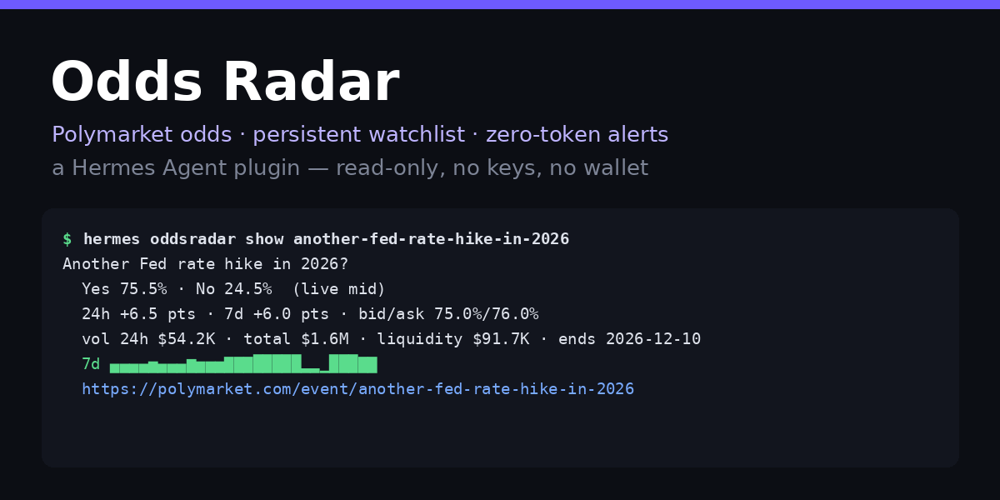
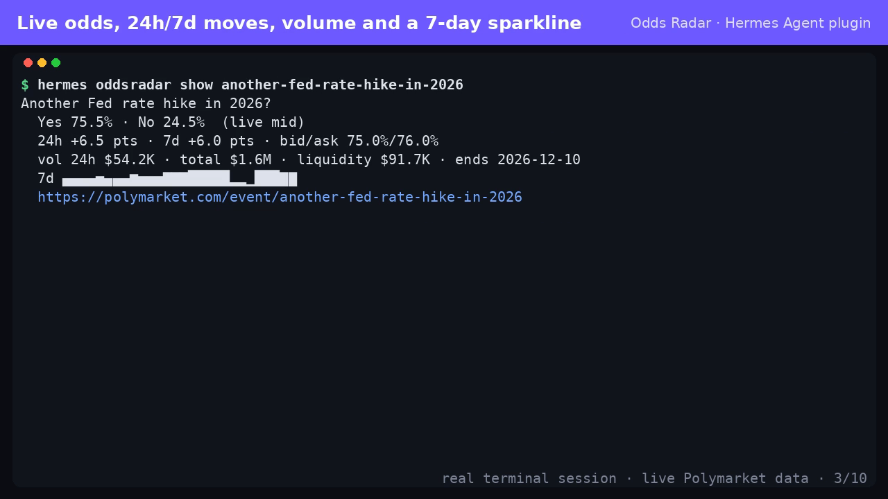
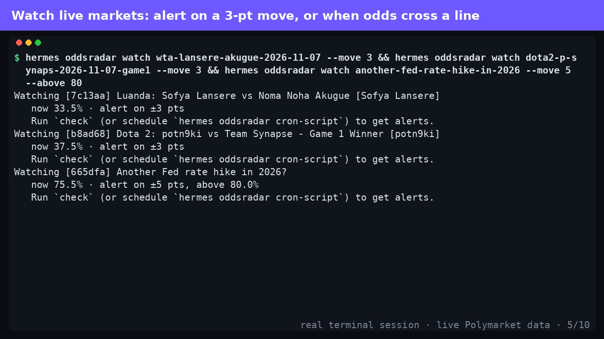
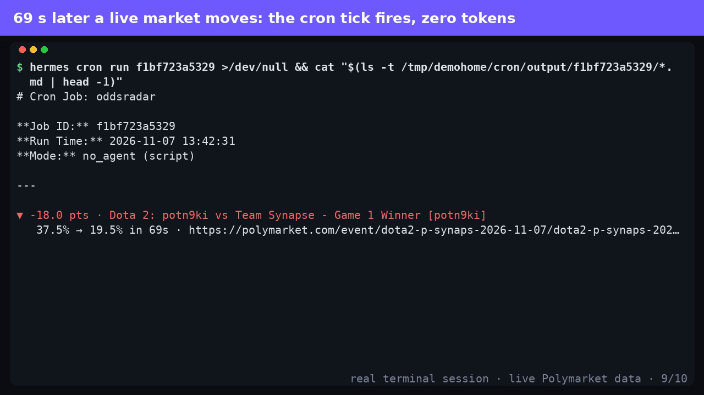

# Odds Radar for Hermes Agent

**Polymarket odds inside Hermes, with a watchlist that alerts you for free.**

Ask Hermes what the market thinks, pin the markets you care about, and get a
Telegram (or Discord, Slack, …) ping the moment the odds move, cross a line or
resolve. The checks run as a Hermes **no-agent cron job**: a script decides,
no model is called, so every check costs zero tokens.

```
$ hermes oddsradar show another-fed-rate-hike-in-2026
Another Fed rate hike in 2026?
  Yes 75.5% · No 24.5%  (live mid)
  24h +6.5 pts · 7d +6.0 pts · bid/ask 75.0%/76.0%
  vol 24h $54.2K · total $1.6M · liquidity $98.2K · ends 2026-12-10
  7d ▄▄▄▄▅▄▄▄▆▅▅▅▇▇▇█████▂▂▁███▇▇
  https://polymarket.com/event/another-fed-rate-hike-in-2026
```

A real alert, delivered by a no-agent cron tick during a live Dota 2 match:

```
▼ -18.0 pts · Dota 2: potn9ki vs Team Synapse - Game 1 Winner [potn9ki]
   37.5% → 19.5% in 69s · https://polymarket.com/event/dota2-p-synaps-2026-11-07/dota2-p-synaps-2026-11-07-game1
```



Read-only by design: no API key, no wallet, no trading.

## Why a plugin and not a prompt

A skill can tell a model how to curl an API. It cannot remember what you are
watching, notice a move while you are away, or stay quiet when nothing happened.
Odds Radar adds the parts a prompt can't:

- **A persistent watchlist** per Hermes profile (`plugin-data/oddsradar/watchlist.json`,
  atomic writes, shared safely by chat, CLI and cron).
- **A deterministic alert engine**: move rules measured from the last alert
  (so one move alerts once), edge-triggered `above`/`below` thresholds with a
  1-point re-arm gap (no flapping), and a one-time alert when a market resolves,
  after which the watch removes itself.
- **Zero-token alerts**: `hermes oddsradar cron-script` writes a script for
  Hermes's no-agent cron mode. It prints only when something fired, so silent
  ticks send nothing and no tick ever calls a model.
- **The same engine on three surfaces**: agent tools, the `/odds` slash command
  in any chat (no LLM round trip), and a `hermes oddsradar` CLI.
- **Live prices**: the CLOB midpoint, falling back to the Gamma snapshot, plus
  24h/7d moves, bid/ask, volume, liquidity and a 7-day sparkline.

## Install

```bash
hermes plugins install oddsradar --enable    # once listed in the catalog
# or, from this repository:
hermes plugins install https://github.com/WV629/hermes-oddsradar --enable
```

Requires Hermes `>=0.22.0`. Standard library only; no Python dependencies.

## Use it

In any chat (Telegram, Discord, CLI, Desktop):

```
/odds fed rates                          search active markets
/odds show <polymarket url or slug>      live odds, moves, volume, sparkline
/odds watch <url|slug> move=3 above=80   add to the watchlist
/odds list                               what you are watching
/odds check                              evaluate now
/odds movers                             biggest 24h moves among the most-traded markets
/odds unwatch <id>
```

Or just ask Hermes: *"what are the odds of another Fed hike this year? Watch it
and tell me if it moves 5 points."* The model uses the tools below.

From a terminal, the same commands live under `hermes oddsradar …`
(`search`, `show`, `watch --move/--above/--below/--outcome`, `list`,
`unwatch`, `check [--quiet]`, `movers`, `cron-script`).

### Zero-token alerts to your phone

```bash
hermes oddsradar cron-script     # writes ~/.hermes/scripts/oddsradar-check.py
hermes cron create "every 15m" --no-agent --script oddsradar-check.py \
  --deliver telegram --name oddsradar
```

Every 15 minutes the script runs `hermes oddsradar check --quiet`. Nothing
moved: no output, no message. A rule fired: the alert text is delivered to your
Telegram home channel. No model is involved at any point.

### Rules

| Rule | Fires when | Then |
|---|---|---|
| `move=N` | odds move N percentage points from the baseline (default 5) | baseline resets to the new price |
| `above=P` | odds rise to P% | fires once; re-arms after dropping 1 pt below P |
| `below=P` | odds fall to P% | fires once; re-arms after rising 1 pt above P |
| *(always)* | the market closes / resolves | one final alert, watch removed |

`outcome=No` (or any outcome name) watches a different side of the market.
Multi-market events (e.g. a nominee race) list their market slugs so you can
pick one.

## Screenshots

| Live odds | Watchlist | A zero-token alert |
|---|---|---|
|  |  |  |

## Agent tools

| Tool | What it does |
|---|---|
| `odds_search` | search active markets, with current odds per market |
| `odds_market` | live detail for one market (midpoint, moves, volume, liquidity, resolution, sparkline) |
| `odds_watch` | add / remove / list watches |
| `odds_check` | evaluate the watchlist (`peek=true` looks without consuming alerts) |
| `odds_movers` | biggest 24h moves among the most-traded markets |

All handlers return JSON and never raise.

## Disclosure

- **Network:** read-only HTTPS GETs to `gamma-api.polymarket.com` (search and
  market data) and `clob.polymarket.com` (midpoints and price history), only
  when a tool, slash command, CLI command or your cron job runs. The client
  refuses any other host. 10 s timeout, at most 2 retries on 429/5xx, so an
  outage fails cleanly under cron and the gateway.
- **Credentials:** none. No keys, no wallet, no account, nothing stored.
- **Files:** the watchlist at `<HERMES_HOME>/plugin-data/oddsradar/watchlist.json`.
  `hermes oddsradar cron-script` (only when you run it) writes
  `<HERMES_HOME>/scripts/oddsradar-check.py`, which runs
  `hermes oddsradar check --quiet` as a subprocess (argv, no shell, stdin closed,
  120 s timeout). The plugin itself never creates cron jobs; you schedule the
  script with `hermes cron create`.
- **No** telemetry, background threads, self-updating code, core overrides,
  hooks or middleware. Market data is information, not financial advice.

## Development

```bash
python -m pytest -q tests                 # 25 offline tests, fake transport, no network
hermes plugins validate . --install-deps  # catalog admission check
hermes plugins doctor . --ci
```

## License

MIT © 2026 WV629
